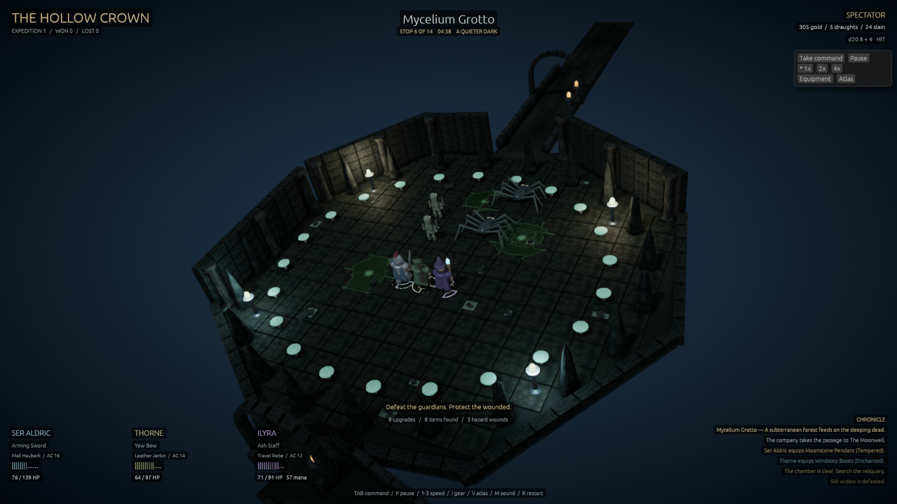

# The Hollow Crown — Below the Abbey

A native 3D fantasy dungeon crawler built through the engine MCP. A knight, ranger,
and elven arcanist explore a sprawling ruined abbey beneath the earth. The cutaway
tabletop style uses worn stone, carved arcades, banners, spectral light, and miniature
adventurers. This expanded version adds a branching dungeon, equipment progression,
minibosses, lasting wounds, and uncertain outcomes.



## Watch or play

From the engine repository root:

```sh
./run-hollow-crown.sh
```

Alternatively, use `./target/debug/player games/hollow-crown`, or open this folder in
the editor and press Play. Spectator mode starts automatically: the party explores,
fights, manages supplies, equips better finds, chooses routes, and begins a fresh
expedition after victory or defeat. Gear belongs to the current expedition and resets
with the next company.

| Key | Action |
| --- | --- |
| Tab | Spectator / manual command |
| P | Pause / resume |
| 1 / 2 / 3 | 1x / 2x / 4x speed |
| I | Inspect the company's equipment and combat stats |
| V | Open the dungeon atlas |
| C | Toggle gentle camera movement |
| M | Mute / restore audio |
| R | Start a new expedition |
| WASD / arrows | Move the living leader, relative to the camera |
| Left click | Walk to a point on the floor |
| Space (hold) | Attack in manual mode |
| Q | Ilyra's frost nova, costing mana |
| E | Use a limited healing draught on the weakest living hero |
| F | Search a cleared reliquary when nearby |
| J / K | Choose the first / second passage at a fork |

The ranger and mage continue using their combat AI during manual command. A surviving
adventurer takes the lead if the knight falls. The UI buttons also control mode,
pause, speed, equipment, atlas, and route choices.

## A longer, varied dungeon

There are **16 chambers and 17 passages**. Each expedition visits **14 chambers**, taking
one route at each of two forks. The map is authored; routes, omens, encounters, attack
rolls, trap detection, and loot vary between runs. Corridors bend, change width, and
cross wooden bridges rather than simply joining identical squares.

- **Vigil Nave:** a long abbey aisle with carved piers and tombs.
- **Drowned Cistern:** an oval chamber with poison pools.
- **Chapel of Last Mercy / Silk Warrens:** a costly blessing or a spider-filled cavern.
- **Royal Ossuary:** broad aisles of ancient coffins.
- **The Bone Abbot:** an octagonal crypt and the first miniboss.
- **Mycelium Grotto:** an irregular cavern of fungi, ghouls, spiders, and venom.
- **The Moonwell:** a circular library and a limited restorative spring.
- **Smugglers' Refuge / Ashen Foundry:** supplies and a possible ambush, or a weapon cache.
- **The Glass Oracle:** an octagonal rotunda and a ranged spellcasting miniboss.
- **Broken Gallery:** an asymmetrical hall reached across a winding bridge.
- **Ember Crucible:** a cruciform room with telegraphed fire eruptions.
- **Knife Catacombs:** an L-shaped chamber and trapped approaches.
- **Hall of Iron Penance:** an elongated chain-lined hall and an armored miniboss.
- **Throne of the Unburied:** a large apsidal throne room and the final king.

The Bone Abbot raises fallen sentinels. The Glass Oracle aims shattering ground spells.
The Iron Confessor breaks armor with shockwaves. The king combines eruptions and
reinforcements. Bowmen and heralds threaten wounded companions; ghouls and spiders
spread poison. Passage traps include spikes, webs, fire, and rockfall warnings. Thorne
can detect some threats, while the party's delayed dodge reactions can fail.

## Gear, supplies, and risk

Finds range from **Worn** to **Tempered**, **Enchanted**, and **Relic**. Each character has
four slots: weapon, armor, boots, and charm. Class-compatible improvements are equipped
automatically; weaker or unusable items are salvaged for gold. Equipment changes damage,
attack accuracy, armor, maximum health, speed, attack timing, mana, and resistance.
Enchanted weapons can critically hit on a 19. Axes, crossbows, armor colors, and staff
ornaments show upgrades on the models as well as in the UI.

Draughts are limited and have a cooldown. Chests do not heal the whole party. Equipping
armor with more maximum health does not mend existing wounds. Poison lingers, and
ordinary healing does not revive a fallen adventurer. The Chapel can restore one fallen
hero for 90 gold, or bless the living for 45 gold. The Moonwell heals the living and
restores mana once; it does not grant a full reset or revive companions. Choosing the
Refuge trades a possible ambush for additional supplies; the Foundry offers a weapon.

## Verification

Ten seeded expeditions using the same 0.05-second gameplay tick produced **three wins
and seven defeats**. They finished in **10.7–13.5 minutes** at normal game speed. One
victory left only Thorne alive with **27 HP**. This is a recorded sample, not a guaranteed
win rate. Only presentation was disabled for this fast balance sweep.

Two full rendered fixed-step tests separately confirmed a victory and a party wipe.
Additional checks cover actual equipment benefits, downgrade rejection, class matching,
avoiding free healing, automatic defeat recovery, manual movement, pause, equipment UI,
and arriving at a new room without hitting exact AI waypoints. The current scenarios
and results are under `tests/expansion/`; old-version reports are in `tests/legacy-v1/`.

With this project open and stopped in the editor, run:

```sh
python3 games/hollow-crown/tools/verify.py --port 47811
```

You can also replay a scenario through MCP, for example:
`playtest {scenario: "games/hollow-crown/tests/expansion/victory.json"}`.
`RT.restart(seed)`, `RT.room(n)`, `RT.status()`, `RT.gear()`, and `RT.walkable()` provide
targeted inspection; `RT.run(seed, steps)` runs the presentation-free balance check.

The saved project passed validation and loaded in the standalone player. A 300-frame
native profile measured **16.24 ms median / 18.13 ms p95**, with no entity, material,
mesh, texture, or script count growth. These are CPU frame timings including display
waits. Hot reload preserved state and kept effect handles valid without warnings.

## Files and authoring

- `content/scripts/game.lua`: combat, expedition director, hazards, and spectator camera.
- `content/scripts/loot.lua`: item generation, upgrade comparison, and derived stats.
- `content/scripts/navigation.lua`: collision grid and heap-based A*.
- `content/scripts/world.lua`: shared room polygons, obstacles, corridor paths, and torches.
- `content/scripts/hud.lua`: HUD, equipment, atlas, and route controls.
- `world.json`: the corresponding authoring data.
- `expansion-*.json`: MCP geometry recipes for the expanded world and enemy variants.
- `content/scenes/`: the saved meshes and scene. Its JSON was compacted after the final
 MCP save, reducing the same scene data from 202 MB to 67 MB. A future editor save will
 pretty-print it again.
- `content/textures/` and `content/audio/`: engine-generated PBR maps, sounds, and recipes.
- `../../feedback.md`: MCP pain points and workarounds recorded during both iterations.

All art and audio were generated locally with engine tools; playing requires neither
MCP nor downloaded assets. The engine's Rust sources were not changed.
