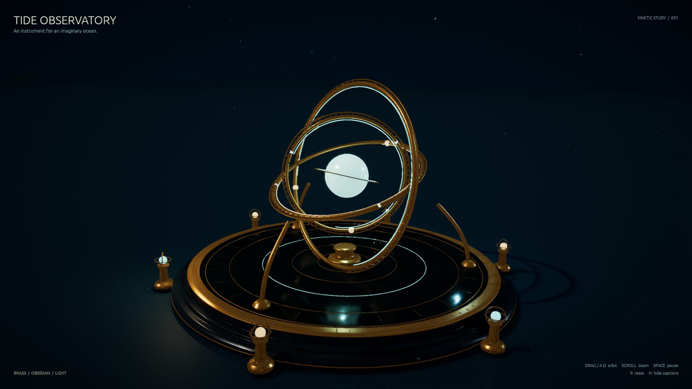

# The Tide Observatory

A kinetic sculpture for an imaginary ocean: nested brass orbits, a breathing pearl, an engraved obsidian reflecting basin, six lanterns, and drifting cyan motes under distant stars.

Built through the engine MCP using procedural swept tubes, turned profiles, composed meshes, generated PBR textures, and Lua. The saved scene includes its geometry and uses project-relative asset paths.



## Run

From the engine repository root:

```sh
./run-tide-observatory.sh
```

The launcher builds the player and opens this demo. Alternatively, use
`cargo run --all-features --bin player -- games/tide-observatory`, or open this
directory as a project in the editor and press Play.

The WASM package compiles, but the browser smoke test exposes existing engine
issues with percent-escaped material filenames and particle rendering on adapters
without bindless textures. Use the native player for this demo until those browser
runtime issues are fixed.

## Controls

- Drag or A / D / Left / Right: orbit the camera.
- Scroll: zoom.
- Up / Down: raise or lower the camera.
- Space: pause or resume the sculpture and camera drift.
- R: reset the composition.
- H: hide or show captions.

## Authoring and checks

`scene-recipe.json` records the deterministic texture recipes and MCP scene calls. `content/scripts/observatory.lua` animates the saved parts without creating geometry each frame.

MCP project validation passed without errors or warnings. Nine deterministic playtest assertions passed across 600 simulation steps, covering animation, pause, resume, captions, reset, camera orbit, zoom, and stable mesh counts. Framing was inspected at 16:9 and 4:3, and the saved project was reopened in the native player. `verification.json` records the checks and a 180-frame native player timing sample.

This demo also exercises the engine fixes for level Lua `look_at` camera orbits,
camera roll updates, and matching the TAA projection in ambient occlusion and
reflection passes. Temporal anti-aliasing is enabled in the saved scene.
